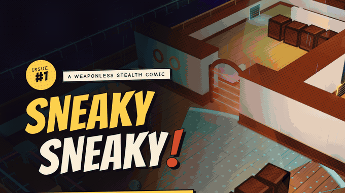

# Sneaky Sneaky

**[sneakysneaky.win](https://sneakysneaky.win/)**

<p align="center">
  
</p>

A weaponless, pacifist HD-2D comic-book stealth puzzle game for the browser, with proper
desktop controls and portrait + landscape phone controls.

No weapons, ever. Sneak past guards, crouch behind cover, crawl vents, knock
to distract, put the occasional guard to sleep, and steal extremely silly
treasure. If a guard's vision cone fills up, the `!` pops and the mission is
over — one tap (or `R` / `Space`) and you're back at the start of the room.

Everything is procedural: rooms, guards, textures, characters, loot props and
sound. There are no downloaded assets.

## Infinite loot and venues

Every room rolls its own heist target and its own address from the seed.

- **Targets** are assembled from word banks as
  `[Owner] [Adjective] [Material] [Object] [(Tag)]`, for example *The
  Trustees' Overdue Toaster (Missing One Screw)* or *An Unclaimed Classified
  Carbon-Fibre Fire Hydrant (Slightly Haunted)*. Owners are theme-specific
  plus a universal pool. That is roughly 39 million names per theme.
- About 15% of rooms drop one of the 28 handcrafted **SIGNATURE** classics.
- Each target has a tagline, a serial (`FILE #492-K`) and a rarity
  (`CONTRABAND`, `RARE`, `ABSURD`, `SIGNATURE`).
- Each also has a `propSpec`, which `src/render/lootProps.js` turns into a
  smooth, cel-shaded, ink-outlined 3D prop: one of 34 base silhouettes, coloured by
  the material word (a *Brass* anything is brass), with optional glow
  (*Haunted*, *Mildly Radioactive*, *Neon*…), tilt, scale and a topper
  (ribbon, price tag, bow, evidence marker, or a halo on ABSURD drops).
- **Venues** are generated the same way: *M/Y Quiet Money VII · Tender
  Garage*, *Ledger Tower · Floor 97 (Executive Wing)*, *Sub-Level 22 ·
  Condemned Containment D*, *VR Simulation 0x9F · Ghost Protocol 07*.
- The **Loot Vault** files every unique artifact with its venue, sector,
  rarity, serial and best rank. It filters by rarity, pages 36 at a time, and
  keeps the newest 500 unique items (signature pieces are never evicted).

Difficulty never changes the prize: target and venue depend only on the seed
and theme.

## The cast

**The thief** is one fixed figure: an anonymous burglar in matte black from
mask to boots, with slate-blue comic rim light. No name, no face, no
customisation; pressing **START HEIST** goes straight into the heist.

**Guards** are procedurally generated per room from five comic archetypes,
weighted by setting, each with randomised build, skin tone, hair, headwear,
eyewear, facial hair, scarf, badge, uniform colours and hand prop:

| Archetype | Look | Mostly found |
| --- | --- | --- |
| Heavy Enforcer | broad bruiser in a coat or vest, shades, flashlight or baton | yacht, bunker |
| Night Watchman | rumpled uniform, peaked cap, thermos or keys, a bit of a belly | office, museum |
| Tech Specialist | visor helmet or headset, utility vest, glowing scanner | lab, VR |
| Gala Security | tailored blazer and tie, earpiece, slick hair or fedora | yacht, museum |
| Tactical Officer | greatcoat or field jacket, beret, epaulettes, radio | bunker |

The definitions live in `src/core/cast.js` and are unit tested.

## Art direction

A hyper-modern graphic novel in HD-2D: hand-inked 2D comic characters standing
in a smooth, lit 3D diorama.

- **Characters are 2D illustrations**, not 3D models. `src/render/sprites.js`
  poses a small skeleton (six-frame walk cycle, prowling crouch, sleeper hold,
  startled recoil, look-around, asleep on the floor), projects it from one of
  five view angles (front, 3/4, profile, 3/4 back, back; mirrored for the other
  side) and draws over it in Canvas2D: variable-weight ink, flat colour, a cel
  fold, a rim highlight and Ben-Day dots. Frames are drawn on demand at
  512 px (thief) or 384 px (guards) and cached.
- **Standees in 3D** (`src/render/character.js`): each character is a
  camera-facing plane that picks its view from the angle between its heading
  and the camera, leans back as the camera climbs, casts a real alpha-tested
  shadow and sits on a soft contact shadow. Behind scenery it shows as a flat
  silhouette.
- **The diorama** is smooth and modern: bevelled furniture, round rails and
  pods, arched doorways, cel-shaded materials, high-resolution painted
  textures with linear and anisotropic filtering. Nothing is pixelated.
- **Print finish** (`src/render/comicPass.js`), at native resolution: thin ink
  accents on strong edges, a rich colour grade, a rotated Ben-Day halftone
  screen in the shadow midtones, soft bloom and a gentle vignette.
  **Visual Style** in the pause menu: `Comic Print` (default) or `Clean Ink`.
- **Six colour stories**: indigo sea and golden deck lamps on mahogany
  (yacht), twilight cobalt with cyan monitors and amber pools (office),
  slate-teal with mint pods and warm-white spots (lab), indigo dusk over
  sienna stone (bunker), plum and emerald marble under gold spots with crimson
  velvet (museum), navy void with electric cyan and magenta (VR).
- **Cones and lettering**: vision cones are translucent washes with a halftone
  fill and an inked edge; `TAP! TAP!`, `SHHH...`, `ZZZ...`, `YOINK!` and the
  `?!` / `!!` bursts are drawn as hand-lettered stamps in the world.
- **Interface**: cream comic panels with ink borders and hard offset shadows,
  yellow caption boxes, a cover-style title ("ISSUE #1"), `BUSTED!!` and
  `CLEAN GETAWAY!` bursts. In play the HUD stays in the corners and the issue
  banner is a lower-third box that clears in about 1.8 s.

## Play

```bash
npm install
npm run dev        # http://localhost:5173
```

| Action | Desktop | Mobile |
| --- | --- | --- |
| Move (camera-relative) | `WASD` / arrows | Left-half floating thumbstick (soft tilt = tiptoe, full = jog) |
| Crouch | `C` toggle, `Shift` hold | **CROUCH** |
| Context action (choke / vent / grab / switch) | `E` / `Space` | **ACTION** (label changes to `CHOKE`, `VENT`, `GRAB`, `SWITCH`) |
| Knock distraction | `Q` / `F` | **KNOCK** |
| Orbit camera | Mouse drag, `J` / `L` | Drag the right side, pinch to zoom |
| Zoom | Scroll wheel | Pinch |
| Chase / Overhead Tactical camera | `V` | **CAM** |
| Retry room | `R` | Tap **RETRY** |
| Mute | `M` | Pause menu |
| Pause | `Esc` / `P` | Pause button |

### How it works

- **Vision cones are real.** Each cone is raycast against the room every
  frame, so walls and cover visibly cut it. The washed part sees you even
  crouched; the dots-only part only sees you standing (it's looking over
  waist-high cover).
- **Detection is a meter, not a tripwire.** Close up it fills almost
  instantly; at the far edge you get about a second. Cyan → amber `?` → red `!`.
- **Jogging is loud.** Running next to a guard makes them turn round.
  Crouching and tiptoeing are silent.
- **Sleeper hold.** Get close, directly behind a guard, and take the prompt.
  A guard who spots a sleeping colleague walks over and wakes them up.
- **Knock** sends guards in earshot to investigate where you were standing.
- **Vents** link two grates of the same colour. **Lasers** need their wall
  switch, or a vent around them.
- **Rank** (S / A / B) comes from time against the ghost par, knockouts and
  close calls. Zero knockouts earns the Ghost Bonus. Loot goes in the Vault.

### Difficulty and the endless ramp

**Mission Setup** (title screen and pause menu) lets you pick your own curve.
It is saved in `localStorage` and mirrored into the address bar, so a link
reproduces the exact setup.

| Difficulty | Detection | Cone reach | Also |
| --- | --- | --- | --- |
| Tourist (Relaxed) | 0.65× | 0.88× | calmer patrols, fewer guards, puzzles arrive later |
| Operative (Classic) | 1× | 1× | the default |
| Shadow (Hard) | 1.35× | 1.12× | brisker patrols, more guards, lasers and extra vents from room 1 |
| Ghost Master (Extreme) | 1.7× | 1.22× | dense guards, lasers and vents, compounds two size tiers bigger |

| Ramp pace | Size tier gained per room |
| --- | --- |
| Steady | 0 — stays at your starting size forever |
| Gradual | ½ |
| Classic | 1 |
| Turbo | 2 |

| Starting size | Tier | Roughly |
| --- | --- | --- |
| Compact | 1 | 3 chambers, 1 guard |
| Standard | 4 | 4–5 chambers, 4 guards, first lasers |
| Large Compound | 8 | ~7 chambers, 6 guards, 3 vents |
| Mega-Facility | 14 | 48 × 30 m, 10–15 chambers, 9–14 guards, ~5 vents, 2–3 laser doors |

Rooms stop growing at tier 20 but the run never ends. **Fine tuning** adds
Guard Alertness (50–200 %) and Vision Range (80–130 %) sliders on top of the
preset, and Setting can be Endless Shuffle or locked to one theme. The HUD,
room briefing and clear screen show the current state, e.g.
`SECTOR 07 · LARGE COMPOUND · OPERATIVE · CLASSIC RAMP` (a `+` after the
difficulty means the sliders are off default).

Vision range, patrol speed and guard count feed the generator, so the ghost
route is re-proved for whatever you pick. Detection speed only changes how
quickly a guard who *can* see you reacts, so it never affects solvability.

### URL parameters

| Parameter | Effect |
| --- | --- |
| `?seed=anything` | Reproducible run. Room *n* uses seed `anything#n`. |
| `?theme=yacht\|office\|lab\|bunker\|museum\|vr` | Lock the setting. |
| `?diff=tourist\|operative\|shadow\|master` | Difficulty preset. |
| `?ramp=steady\|gradual\|classic\|turbo` | Ramp pace. |
| `?start=compact\|standard\|large\|mega` | Starting size. |
| `?alert=1.25` `?vision=1.1` | Fine-tuning sliders. |
| `?level=5` | Debug: add 4 extra size tiers to every room. |
| `?lowpower` | Force the mobile quality tier (no bloom, smaller shadow map). |
| `?nobloom` | Disable post-processing only. |

## Guaranteed-solvable rooms

`src/core/generator.js` builds each room from a seed: a BSP of chambers joined
by doorways, waist-high cover, crawl vents, laser doors with switches, a loot
pedestal, an extraction pad and guards on loop / ping-pong / lookout patrols.

Every room is then checked by two verifiers in `src/core/solver.js` before it
is ever returned:

1. **Topology** — BFS over (cell × carrying-loot × lasers-off) proves the loot
   and exit are physically reachable using doors, vents and switches.
2. **Ghost route** — BFS over a time-expanded graph. Guard patrols are pure
   functions of time (`src/core/patrol.js`), so the solver knows exactly where
   every cone will be. It searches for a crouch-walk route that is never
   inside any padded vision cone, with no knockouts and no distractions.

If no ghost route exists the guards are re-rolled, and as a last resort
thinned out. So every room can be beaten as a perfect ghost; knockouts and
knocking are there to make it easier, never because you have to.

## Project layout

```
index.html            HUD, menus and touch controls markup
src/main.js           entry point
src/style.css         all UI styling (100dvh, safe-area insets, portrait/landscape)
src/core/             pure logic, no three.js, unit tested
  rng.js              seeded PRNG
  cast.js             the thief and the five guard archetypes
  grid.js             cells, DDA raycast, line of sight, pathfinding
  patrol.js           patrol timelines (pose as a function of time)
  stealth.js          vision, detection rate, choke-out arc, ranking
  solver.js           topology + time-expanded ghost-route verifiers
  generator.js        room generator
  difficulty.js       presets, ramp maths, shareable setup params
  themes.js           the six settings and the venue-name generator
  loot.js             signature items and the procedural loot engine
src/render/           three.js: 2D comic sprite illustrator, standee rigs, painted
                      textures, world, cones, comic stamps, print finishing pass
src/game/             game loop, camera, input, audio, save data
src/ui/               HUD/menus, radar, mission setup panel
tests/                node:test suites
public/               _headers, favicon.svg, site.webmanifest
```

## Scripts

```bash
npm test         # unit tests: 250+ seeded rooms, presets, size tiers, 3000 loot drops
npm run lint     # ESLint 9 flat config, zero warnings allowed
npm run build    # static site in dist/, ready for Cloudflare Pages
npm run preview  # serve dist/ locally
```

The tests cover solvability (both verifiers, plus a continuous replay of each
ghost route against the real vision code), vent placement and connectivity,
laser/switch pairing, patrol validity, line-of-sight and cover occlusion, the
choke-out angle maths, every difficulty preset, the ramp-pace calculations, and
Large Compound / Mega-Facility generation speed and solvability.

## Deploying

Cloudflare Pages: build command `npm run build`, output directory `dist`.
`public/_headers` sets the security headers and cache rules (hashed bundles
under `/assets/` are immutable; `index.html` always revalidates).

## License

MIT — see `LICENSE`.
